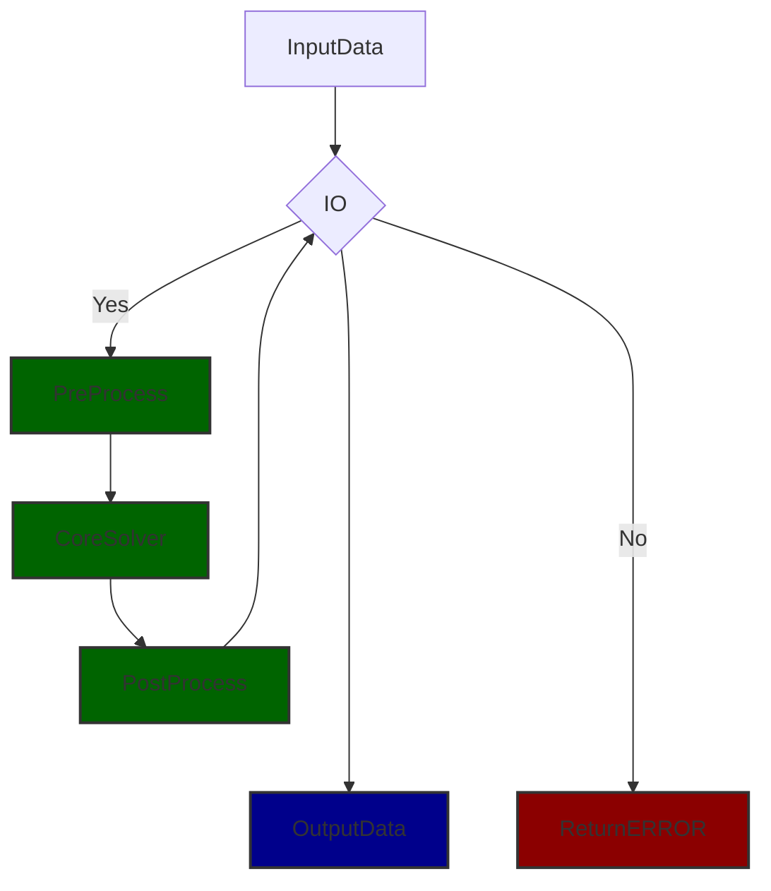
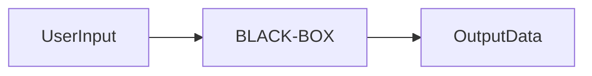
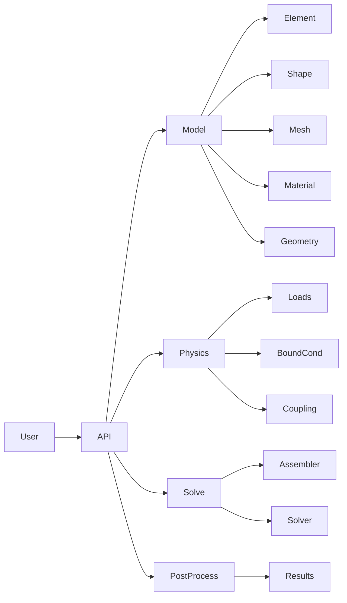
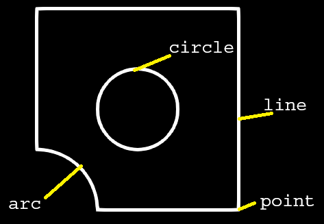

[TOC]

# User’s Guide

This guide introduces the components and commands that define the configuration file required to execute an analysis using **MYFEMPY**. Depending on the problem setup, adjustments may be necessary; please refer to the _help_ or _API_ documentation for details. Additional [Tutorials](#tutorials) are provided at the end of this guide.

## Presentation

The *myfempy* project was developed as a finite element solver for multi-physics simulations, intended for academic and research use. Originating from the author’s doctoral thesis, the project has matured into a robust computational framework. Its primary goal is to provide an accessible yet powerful environment for simulation setup and execution, minimizing the need for advanced prior knowledge of numerical methods while maintaining flexibility for expert users.

At its core, *myfempy* implements a finite element processor that drives the numerical analysis. The workflow is organized into three principal stages:

- **Pre-processing**  
  - Configuration is performed through API commands.  
  - Users specify material properties, element types, and boundary conditions.  
  - Mesh generation is managed via **Gmsh**, which supplies both geometry and discretization data.

- **Processing**  
  - The solver core executes finite element computations according to the defined physics and constraints.  
  - Multi-physics coupling is supported, enabling integration of multiple physical domains within a single simulation.

- **Post-processing**  
  - Results are exported in formats compatible with visualization tools.  
  - Output data is structured as **VTK files**, which can be analyzed and visualized using **ParaView**.  

This architecture emphasizes modularity, extensibility, and interoperability with established open-source tools, positioning *myfempy* as a versatile platform for computational mechanics and multi-physics research. A typical analysis workflow involves submitting requests (Python dictionaries) through a specific script pattern. The user imports the desired solver, configures the problem by defining materials, finite elements, and geometry, and generates a mesh via Gmsh. Loads and boundary conditions are applied, and the solver computes the solution. Results are exported and visualized in ParaView.


To ensure organized execution, *myfempy* employs a hierarchical code structure that integrates user requests into a processing pipeline. Input data is validated through controllers in the I/O interface. If commands and data are consistent, they are passed to the solver core, where pre-processing, solution, and post-processing occur. The processed data is then returned through the I/O filters and exported as visualization-ready files (VTK).



## How it Works

*myfempy* is implemented using an object-oriented paradigm, structured around the **Bridge design pattern**. The system is composed of multiple classes, with user interaction facilitated through APIs that orchestrate the execution of the solver.

The project adopts a **black-box architecture**: users provide input data, the solver executes the numerical routines, and the system returns output data along with logs for validation.



The main API provides direct access to the core components of the project, enabling construction of the **Model**, definition of **Physics**, and execution of the **Solution**.



<!-- 
### Abstract implementation of the API ClassService

**Model Class**  
  - Element  
    ```python
    --8<-- "myfempy/core/elements/element.py"
    ```
  - Shape
    ```python
    --8<-- "myfempy/core/shapes/shape.py"
    ```
  - Mesh
    ```python
    --8<-- "myfempy/core/mesh/mesh.py"
    ```  
  - Material
    ```python
    --8<-- "myfempy/core/material/material.py"
    ```  
  - Geometry
    ```python
    --8<-- "myfempy/core/geometry/geometry.py"
    ```  

**Physics Class**  
  - Loads and Bound. Cond.
    ```python
    --8<-- "myfempy/core/physic/structural.py"
    ```

**Solver Class**  
  - Assembler
    ```python
    --8<-- "myfempy/core/solver/assembler.py"
    ```  
  - Solve
    ```python
    --8<-- "myfempy/core/solver/solver.py"
    ```    

**Results Class**  
  - Post-processing and data export  
-->

---

## Pre-Process

### API and Solver

```python
# ==============================================================================
# Import newAnalysis to set up a new problem
# ==============================================================================
from myfempy import newAnalysis

# ==============================================================================
# Import a solver to run and analyze the problem set, e.g., SteadyStateLinear
# ==============================================================================
from myfempy import Solver

# ==============================================================================
# Initialize fea as the API to run the Solver Analysis
# ==============================================================================
fea = newAnalysis(Solver)
```

### Solvers

```python
# ==============================================================================
# Currently available solvers for import into the myfempy library
# > See: Table 3 - Solvers List for more information
# ==============================================================================

# Standard Solver Options
"SteadyStateLinear"                 # Steady State Linear Solver Class
"SteadyStateLinearIterative"        # Steady State Linear Iterative Solver Class
"DynamicEigenLinear"                # Dynamic Eigen (modal problem) Linear Solver Class
"DynamicHarmonicResponseLinear"     # Dynamic Harmonic Response Forced System Steady State Linear Solver Class

# Advanced Solver Options [adv]
"StaticLinearCyclicSymmPlane"       # Static Linear Cyclic Symmetry Plane Solver Class
"PhononicCrystalInPlane"            # Phononic Crystal In-Plane Solver Class
"HomogenPlane"                      # Homogenization Plane Solver Class
```

---

### Model

```python
# ==============================================================================
# modeldata is a Python dictionary that contains the commands for model setup
# ==============================================================================
modeldata = dict()
```

#### Material

```python
# ==============================================================================
# Configure material
# ==============================================================================
modeldata["MATERIAL"] = dict()
```

##### Keys

```python
# ------------------------------------------------------------------------------
# Material Set (> See: Table 4 - Material List for more information)
# ------------------------------------------------------------------------------
"MAT": str()
    # Options:
    'lumped'                        # Lumped material
    'uniaxialstress'                # Axial (rod, beams, etc.) behavior material
    'planestress'                   # Plane stress behavior
    'planestrain'                   # Plane strain behavior
    'solidelastic'                  # Solid behavior material
    'heatplane'                     # Heat behavior material
    'heatsolid'                     # Heat behavior material

    # [dev]
    'fluid'

# ------------------------------------------------------------------------------
# Material Behavior
# ------------------------------------------------------------------------------
"TYPE": str()
    # Options:
    'isotropic'                     # Isotropic stress/strain material
    'usermaterial'                  # User-configured material

# ------------------------------------------------------------------------------
# Material Properties (> See: Appendix: Table 5 - Consistent Units for more information)
# ------------------------------------------------------------------------------
"PROPMAT": list[mat_set_1:dict(), ..., mat_set_n:dict()]
    # General Options:
    "NAME": str()                   # Material name definition

    # Isotropic Solid Parameters:
    "EXX": float()                  # Elasticity modulus in X direction
    "VXY": float()                  # Poisson's ratio in X direction
    "GXY": float()                  # Shear modulus in X direction
    "RHO": float()                  # Density of material

    # Anisotropic Solid Parameters:
    "EYY": float()
    "VYZ": float()
    "GYZ": float()
    "EZZ": float()
    "VZX": float()
    "GZX": float()

    # Heat Parameters:
    "KXX": float()                  # Thermal conductivity in X direction
    "KYY": float()                  # Thermal conductivity in Y direction
    "KZZ": float()                  # Thermal conductivity in Z direction
    "CTE": float()                  # Coefficient of thermal expansion

    # [dev] Fluid Parameters:
    "VIS": float()                  # Viscosity
    "RHO": float()                  # Density of fluid

    # Lumped Model Parameters:
    "STIFK": float()                # Stiffness K - axial spring
    "STIFT": float()                # Stiffness T - string tension
    "STIFR": float()                # Stiffness R - torsion spring
    "MASS": float()                 # Mass block lumped

# ------------------------------------------------------------------------------
# [adv] User-Defined Material Class Example
# ------------------------------------------------------------------------------
"CLASS": class()                    # User-defined class
    # ==========================================================================
    # Example: SET NEW MATERIAL <ORTHOTROPIC ELASTIC>
    # ==========================================================================
    # from myfempy import PlaneStress
    #
    # class UserNewMaterial(PlaneStress):
    #     def __init__(self):
    #         super().__init__()
    #
    #     def getMaterialSet():
    #         matset = {
    #             "mat": "planestress",
    #             "type": "orthotropic",
    #         }
    #         return matset
    #
    #     def getElasticTensor(tabmat, inci, element_number, a=None, b=None):
    #         # Material elasticity
    #         EXX = tabmat[int(inci[element_number, 2]) - 1]["EXX"]
    #         EYY = tabmat[int(inci[element_number, 2]) - 1]["EYY"]
    #
    #         # Material Poisson ratio
    #         VXY = tabmat[int(inci[element_number, 2]) - 1]["VXY"]
    #         VYZ = tabmat[int(inci[element_number, 2]) - 1]["VYZ"]
    #
    #         # EXX = 45E3                # N/mm^2 --> MPa
    #         # EYY = 12E3                # N/mm^2 --> MPa
    #         # VXY = 0.23
    #         # VYX = 0.66
    #
    #         S00 = EXX / (1 - VXY * VYZ)
    #         S01 = (VYZ * EXX) / (1 - VXY * VYZ)
    #         S10 = (VXY * EYY) / (1 - VXY * VYZ)
    #         S11 = EYY / (1 - VXY * VYZ)
    #         S22 = (EXX * EYY) / (EXX + EYY + 2.0 * EYY * VXY)
    #
    #         D = np.zeros((3, 3), dtype=np.float64)
    #         D[0, 0] = S00
    #         D[0, 1] = S01
    #         D[1, 0] = S10
    #         D[1, 1] = S11
    #         D[2, 2] = S22
    #         return D
    #
    #     def getFailureCriteria(stress):
    #         stress
    #         return super().getFailureCriteria()
    # ==========================================================================
```

#### Geometry

```python
# ==============================================================================
# Configure geometry
# ==============================================================================
modeldata["GEOMETRY"] = dict()
```

##### Keys

```python
# ------------------------------------------------------------------------------
# Geometry Type
# ------------------------------------------------------------------------------
"GEO": str()
    # Options:
    'solid'                         # Solid 3D geometry
    'thickness'                     # Plane geometries, e.g., plane stress, plates
    'frame'                         # Rods, beams, and frames geometries

# ------------------------------------------------------------------------------
# Beam Cross-Section Set (> See: Appendix: Cross Section Dimensions for more information)
# ------------------------------------------------------------------------------
"SECTION": str()
    # Options:
    'rectangle'
    'rectangle_tube'
    'circle'
    'circle_tube'
    'isection'
    'tsection'
    'csection'
    'lsection'
    'userdefined'

# ------------------------------------------------------------------------------
# Geometry Properties
# ------------------------------------------------------------------------------
"PROPGEO": list[geo_set_1:dict(), ..., geo_set_n:dict()]
    # Options:
    "NAME": str()                   # Geometry name definition

    # Parameters defined from user's cross-section:
    "AREACS": float()               # Area cross-section
    "INERXX": float()               # Inertia X direction
    "INERYY": float()               # Inertia Y direction
    "INERZZ": float()               # Inertia Z direction
    "THICKN": float()               # Thickness of plane/plate

    # User set section dimensions (> See: Appendix: Cross Section Dimensions)
    "DIM": dict()                   # Dimensional beam cross section
    {
        "b": float(),               # b size
        "h": float(),               # h size
        "t": float(),               # t size
        "d": float()                # d size
    }

    # User set Center of Gravity coordinates
    "CG": dict()                    # Center of gravity of beam cross section
    {
        "y_max": float(),
        "y_min": float(),
        "z_max": float(),
        "z_min": float(),
        "r_max": float()
    }
```

#### Element

```python
# ==============================================================================
# Configure element
# ==============================================================================
modeldata["ELEMENT"] = dict()
```

##### Keys

```python
# ------------------------------------------------------------------------------
# Finite Element Type (> See: Table 1 - Elements List for more information)
# ------------------------------------------------------------------------------
"TYPE": str()
    # Options:
    'structbeam'                    # Beam Structural
    'structplane'                   # Plane Structural
    'structsolid'                   # Solid Structural
    'heatplane'                     # Plane Heat
    'heatsolid'                     # Solid Heat

    # [dev]
    'structplate'
    'fluid2d'
    'fluid3d'

# ------------------------------------------------------------------------------
# Element Shape (> See: Table 2 - Mesh List for more information)
# ------------------------------------------------------------------------------
'SHAPE': str()
    # Options:
    'line2'                         # Line 2-Node
    'line3'                         # Line 3-Node
    'tria3'                         # Triangular 3-Node
    'tria6'                         # Triangular 6-Node
    'quad4'                         # Quadrilateral 4-Node
    'quad8'                         # Quadrilateral 8-Node
    'hexa8'                         # Hexahedron 8-Node
    'tetr4'                         # Tetrahedron 4-Node
    'usershape'                     # User Defined Shape

# Optional Integration Parameter (> See: Table 2 - Mesh List)
'INTGAUSS': int()                   # Number of points to integrate the mesh
```

#### Mesh

```python
# ==============================================================================
# Configure mesh
# ==============================================================================
modeldata["MESH"] = dict()
```

##### Manual Mesh Options

```python
'TYPE': 'manual'
'COORD': nodes_coord_array
      # [
      # [node_number_1:int, coord_x_node_1:float, coord_y_node_1:float, coord_z_node_1:float]
      # ...
      # [node_number_N:int, coord_x_node_N:float, coord_y_node_N:float, coord_z_node_N:float]
      # ]
      # -----------------------
      # Example:
      # -----------------------
      # nodes_coord_array = [
      # [1, 0, 0, 0]
      # [2, 1, 0, 0]
      # [3, 0, 1, 0]
      # ]

'INCI': mesh_incidence_array
      # [
      # [elem_number_n:int, mat_type:int, geo_type:int, nodes_list_conec_1, ..., nodes_list_conec_n]
      # ...
      # ]
      # -----------------------
      # Example:
      # -----------------------
      # mesh_incidence_array = [
      # [1, 1, 1, 1, 2, 3, 4]
      # ]
```

##### Legacy Mesh Options

```python
'TYPE': 'legacy'
'LX': float()                       # Set a length in X direction
'LY': float()                       # Set a length in Y direction
'NX': int()                         # Set a number of elements in X direction
'NY': int()                         # Set a number of elements in Y direction
```

##### Gmsh Mesh Options [adv]



```python
'TYPE': 'gmsh',
'meshimport': dict()                # Option to import an external Gmsh mesh
      # Options:
      'object': str(object name [.msh2]) # File .msh2 only, mesh from Gmsh [current version]

'cadimport': dict()                 # Option to import a CAD model from any CAD program
      # Options:                                                                                      
      'object': str(object name [.step]) # File .step/.stp only [current version]

# Options to build a model in .geo file (from Gmsh)
'filename': str()                   # Names of output files generated by internal Gmsh generator (.geo, .msh2)

'pointlist': list[]                 # Points coordinate list
# Set:
# [
# [coord_x_point_1:float, coord_y_point_1:float, coord_z_point_1:float]
# ...
# ]
#
#   y
#   |
#   |
#  (1)----x
#    \
#     \
#      z
#
# -----------------------
# Example:
# -----------------------
# points = [
#     [0, 0, 0],
#     [10, 0, 0],
#     [10, 20, 0],
#     [0, 20, 0]
# ]

'linelist': list[]                  # Lines points connectivity, counterclockwise count			
# Set:
# [
# [point_i_line_1:int, point_j_line_1:int]
# ...
# ]
#
# (i)-----{1}-----(j)
#
# -----------------------
# Example:
# -----------------------
# lines = [
#   [1, 2],
#   [2, 3],
#   [3, 4],
#   [4, 1],
# ]
            
'circle': list[]                    # Circle line, counterclockwise count
# Set:
# [
# [R, [CX, CY, CZ], [A0, A1]]       # arc_1
# ...
# ]
#
#       A1    ^
#       |    /
#       |   /
#       |  R
#       | /
#       |/
# (i:CX,CY,CZ)------A0
#
      # Options:
      R: float()                    # Circle radius
      CX: float()                   # Point i center X coord.
      CY: float()                   # Point i center Y coord.
      CZ: float()                   # Point i center Z coord.
      A0: str(e.g., val.='0')       # Angle begin [rad]
      A1: str(e.g., val.='Pi/2')    # Angle end [rad]
#
# -----------------------
# Example:
# -----------------------
# circle = [[30, [100, 100, 0], ['0', '2*Pi']]]

# Circles have priority numbering over arcs; pay attention to plane numbering.
# See the generated model (.geo) in Gmsh for correct setting.
'arc': list[]                       # Arc 3 points needed
# Set:
# [
# [point_i_begin:int, point_j_middle:int, point_k_end:int]
# ...
# ]
#
# -----------------------
# Example:
# -----------------------
# points = [
#     [0, 0, 0],    # Point 1
#     [200, 0, 0],  # Point 2
#     [200, 40, 0], # Point 3   
#     [100, 40, 0], # Point 4
#     [90, 30, 0],  # Point 5
#     [0, 30, 0],   # Point 6
#     [90, 40, 0],  # Point 7
# ]
# lines = [
#     [1, 2],       # Line 1
#     [2, 3],       # Line 2
#     [3, 4],       # Line 3
#     [5, 6],       # Line 4
#     [6, 1],       # Line 5
# ]
# arcs = [
#     [5, 7, 4],    # Arc, adds a new line 6
# ]
# plane = [
#     [1, 2, 3, 6, 4, 5], # Plane 1, line sequence
# ]

# You can add a list of lines to form a plane.
# To remove a plane within another, add the "-" symbol to the number.
# If the same number is followed by another sequence with a positive value,
# the program will remove and add a plane, creating a new material.
'planelist': list[]                 # Planes lines connectivity, counterclockwise count
# Set:														  
# [                                                         
# [line_1_plane_1:int, ..., line_n_plane_1:int]             
# ...                                                               
# ]				
#
# (l)-----{3}-----(k)
#  |               |
#  |               |
# {4}     [1]     {2}
#  |               |
#  |               |
# (i)-----{1}-----(j)
#
# -----------------------
# Example:
# -----------------------
# plane = [[1, 2, 3, 4]]              # Add a new plane with lines 1, 2, 3, 4
# plane = [[1, 2, 3, 4], [-5]]        # Remove line 5 ('circle') from the main plane
# plane = [[1, 2, 3, 4], [-5], [5]]   # Remove line 5 ('circle') and add a new plane 5

'meshconfig': dict()                # Mesh configuration inputs
      # Options:
      'mesh': str()                 # !!! Mandatory option !!! Set a type of mesh used in analysis
      'sizeelement': float()        # Min size of elements
      'numbernodes': int()          # Select a number of nodes in line, only for 'line2'/'line3' (> See: Table 2)
      'extrude': float()            # Extrude dimensional, in Z direction, from an XY plane
      'meshmap': dict()             # Generate a mapped structured mesh
            # Options:
            'on': bool()            # Turn on (True / False)
                  True
                  False
            'edge': [               # Select edge(s) (lines) to map (only when 'on': True)			
                  'all' 
                  or
                  TAGS NUMB: list[int()] # Select all edges or a specific edge
            ]
            'numbernodes': list[int()] # Select a number of nodes in each edge
            # -----------------------
            # Example:
            # -----------------------
            # 'meshmap': {
            #     'on': True,
            #     'edge': [[1, 2, 3], [4, 5, 6, 7]], # or 'all'
            #     "numbernodes": [12, 8]
            # }

      # [adv]
      # Developed a robust Gmsh script that reorders nodes based on spatial coordinates (Z-Y-X)
      # while preserving all physical groups and entity metadata for optimized FEM assembly.
      # It is not compatible with 'meshmap'.
      'reordermesh': bool()         # Turn on (True / False)
                  True
                  False
```

```python
# ==============================================================================
# Finally, pass the modeldata to the Model constructor API with configured data
# ==============================================================================
fea.Model(modeldata)
```

---

### Physics Setting

```python
# ==============================================================================
# physicdata is a Python dictionary that contains the commands for physics setup
# ==============================================================================
physicdata = dict()
physicdata["PHYSIC"] = dict()
```

#### Domain

```python
# ==============================================================================
# Set the domain
# ==============================================================================
physicdata["PHYSIC"]["DOMAIN"]: str()
      # Options:
      'structural'
      'thermal'

      # [dev]
      'fluid'
```

#### Loads

```python
# ==============================================================================
# Configuration of loads applied to physics
# ==============================================================================
physicdata["PHYSIC"]["LOAD"] = list[load_set_1:dict(), ..., load_set_n:dict()]
```

##### Keys

```python
"TYPE": str()                       # Type force definition
      # Options:
      'forcenode'                   # Force in nodes, concentrated load
      'forceedge'                   # Force in edge, distributed load
      'forcesurf'                   # Force in surface, distributed load
      'forcebeam'                   # Force in beam only opt., distributed load

      # [adv]
      'bodyforce'                   # Structural weight, applied in 2D and 3D models                    
      'strainzero'                  # Initial or permanent mechanical strain, applied in 2D and 3D models      

      # Heat options:
      'heatfluxedge'
      'heatfluxsurf'
      'convectionedge'
      'convectionsurf'
      'heatgeneration'

"DOF": str()                        # DOF direction of force
      # Options:
      'fx'                          # Force in X dir.
      'fy'                          # Force in Y dir.
      'fz'                          # Force in Z dir.
      'pressure'                    # Pressure app. in normal direction
      'tx'                          # Torque/moment in X dir.
      'ty'                          # Torque/moment in Y dir.
      'tz'                          # Torque/moment in Z dir.
      'masspoint'                   # Mass concentrated applied in node/point 
      'spring2ground'               # Spring connected node to ground/fixed end
      'damper2ground'               # Damper connected node to ground/fixed end

# ----- OPT. WITH LOC SEEKERS 
"DIR": str()                        # Set direction (> see: Axis Directions)
      # Options:
      'node'                        # Node in mesh
      'lengthx'                     # Length line in X dir., beam only option [legacy version]
      'lengthy'                     # Length line in Y dir., beam only option [legacy version]
      'lengthz'                     # Length line in Z dir., beam only option [legacy version]
      'edgex'                       # Edge def in X dir. (> 'LOC': {'x': float(coord. x), 'y': 999, 'z': float(coord. z)})
      'edgey'                       # Edge def in Y dir.
      'edgez'                       # Edge def in Z dir.
      'surfxy'                      # Surf def in XY plane (> 'LOC': {'x': 999, 'y': 999, 'z': float(coord. z)})
      'surfyz'                      # Surf def in YZ plane
      'surfzx'                      # Surf def in ZX plane

"LOC": dict()                       # Coord. node locator (> see: Axis Directions)
      'x': float()                  # X coord. node
      'y': float()                  # Y coord. node
      'z': float()                  # Z coord. node

# ----- OPT. WITH TAG SEEKERS
"DIR": str()                        # Set direction (> see: Axis Directions)
      # Options:
      'point'                       # Point number in tag list
      'edge'                        # Edge number in tag list
      'surf'                        # Surface number in tag list
    
"TAG": int()                        # Tag number of regions type, used with Gmsh mesh gen, view list

# Look up the corresponding node number in ParaView, and add 1.
# For example: node_paraview = 0 --> 0 + 1 --> MESHNODE = [1]
"MESHNODE": list[int()]             # Select the node ([1]) or nodes list ([1, 2, 3, ...]) directly from the mesh

"VAL": list()                       # Value list of force on steps, signal +/- is the direction
```

#### Boundary Conditions

```python
# ==============================================================================
# Configuration of boundary conditions applied to physics
# ==============================================================================
physicdata["PHYSIC"]["BOUNDCOND"] = list[bc_set_1:dict(), ..., bc_set_n:dict()]
```

##### Keys

```python
"TYPE": str()                       # Type boundary condition definition
      # Options:
      'fixed'                       # Fixed boundary condition u=0
      'displ'                       # Displ boundary condition u!=0

      # [adv]
      'cycsym'
      'bloch'

      # Heat options:
      'insulated'
      'temperature'

"DOF": str()                        # DOF direction of boundary condition
      # Options:
      'ux'                          # Displ in X dir.
      'uy'                          # Displ in Y dir.
      'uz'                          # Displ in Z dir.
      'rx'                          # Rotation in X dir.
      'ry'                          # Rotation in Y dir.
      'rz'                          # Rotation in Z dir.
      'full'                        # Full DOF

# ----- OPT. WITH LOC SEEKERS 
"DIR": str()                        # Set direction (> see: Axis Directions)
      # Options:
      'node'                        # Node in mesh
      'edgex'                       # Edge def in X dir. (> 'LOC': {'x': float(coord. x), 'y': 999, 'z': float(coord. z)})
      'edgey'                       # Edge def in Y dir.
      'edgez'                       # Edge def in Z dir.
      'surfxy'                      # Surf def in XY plane (> 'LOC': {'x': 999, 'y': 999, 'z': float(coord. z)})
      'surfyz'                      # Surf def in YZ plane
      'surfzx'                      # Surf def in ZX plane

"LOC": dict()                       # Coord. node locator (> see: Axis Directions)
      'x': float()                  # X coord. node
      'y': float()                  # Y coord. node
      'z': float()                  # Z coord. node

# ----- OPT. WITH TAG SEEKERS
"DIR": str()                        # Set direction (> see: Axis Directions)
      # Options:
      'point'                       # Point number in tag list
      'edge'                        # Edge number in tag list
      'surf'                        # Surface number in tag list
  
"TAG": int()                        # Tag number of regions type, used with Gmsh mesh gen, view list

# Look up the corresponding node number in ParaView, and add 1.
# For example: node_paraview = 0 --> 0 + 1 --> MESHNODE = [1]
"MESHNODE": list[int()]             # Select the node ([1]) or nodes list ([1, 2, 3, ...]) directly from the mesh

"VAL": list()                       # Value list of displ on steps
```

#### Coupling

```python
# ==============================================================================
# Configuration of coupling applied to physics
# ==============================================================================
physicdata["COUPLING"] = dict()
```

##### Keys

```python
"TYPE": str()
      # Options:
      'thermalstress',              # CouplSolver
      
      # [dev]
      'fsi'

# To perform a coupled analysis, the same model is used, and the post-processing
# data from the first simulation is passed as input to the coupled simulation.
"POST": [PostProcessData]           # Post-processing data from the previous simulation
#                          myfempy solver blackbox structure
#                               First Simulation [1]

# Input                                API                 Outputs
	
# Model [1]                      +---------------+        
# BounCond + Loads [1]   -->     | FirstSolver   |  -->    PostProcessData [1]
# SolverSet [1]                  +---------------+        


#                               Coupled Simulation [2]

# Input                                API                 Outputs
					
# Model [1]                     +---------------+        
# BounCond + Loads [2]  -->     | CouplSolver   |  -->     PostProcessData [2]
# PostProcessData [1]           +---------------+        
# SolverSet [2]					  
```

```python
# ==============================================================================
# Finally, pass the physicdata to the Physic constructor API with configured data
# ==============================================================================
fea.Physic(physicdata)
```

---

## Preview analysis

```python
# ==============================================================================
# Preview set
# ==============================================================================
previewset = {
    'RENDER': {
        'filename': str(),
        'show': bool(),
        # Options:
        #    True
        #    False
        'scale': int(),
        'savepng': bool(),
        # Options:
        #    True
        #    False
        'lines': bool(),            # Wireframe lines
        # Options:
        #    True
        #    False
        'plottags': {
            # Options:
            'point': True,          # / False
            'line': True,           # / False
            'surf': True            # / False
        },
        'cs': True,                 # Beam cross-section view options
    },
}
fea.PreviewAnalysis(previewset)
```

---

## Solver Set

```python
# ==============================================================================
# Solver set
# ==============================================================================
solverset = {
    "STEPSET": {
        'start': int(),             # value start step
        'end': int(),               # value end step
        'step': int(),              # number of steps 
        'modeEnd': int(),           # number of vibration modes
    },

    'DAMP': float()                 # damping ratio of analysis

    "RFSC": True,                   # residual factor and static compensation. Only to DynamicModeSuperposition Solver
    
    # [adv]
    'IBZ': np.array([               # Brillouin zone
        [0.0, 0.0],                 # O 
        [np.pi, 0.0],               # A
        [np.pi, np.pi],             # B
        [0.0, 0.0]                  # O
    ]),

    #             (B)
    #             /^
    #            / |
    #           /  |
    #          /   |
    #         /    |
    #        /     |
    #      </      |
    #      (O)--->(A)    
}
solverdata = fea.Solve(solverset)
```

---

## Post-Process

```python
# ==============================================================================
# Post-process set
# ==============================================================================
postprocset = {
    "SOLVERDATA": solverdata,
    "COMPUTE": {
        'structural': {
            'displ': True,          # / False
            'stress': True,         # / False
            'modes': True,          # / False
        },
        'thermal': {
            'temp': True,           # / False
            'heatflux': True        # / False
        },

        # [dev]
        'fluid',
    },
    "POSTSET": {
        'show': True,               # / False
        'filename': str(), 
        'savepng': True             # / False
    },
    "OUTPUT": {
        'log': True,                # / False
        'get': {
            'nelem': True,          # Number of elements in the mesh
            'nnode': True,          # Number of nodes in the mesh
            'inci': True,           # List of elements
            'coord': True,          # List of nodes coordinate
            'tabmat': True,         # List of material property
            'tabgeo': True,         # List of geometry property
            'bc_list': True,        # List of constraints (boundary conditions)
            'lo_list': True,        # List of loads 
            'u_list': True,         # List of solutions
            'numpy_decimals': int(),# Decimals to print, e.g. 8
        }
    }
}
postprocdata = fea.PostProcess(postprocset)
```

---

## Tutorials

The main objective of these tutorials is to help the user explore the various modeling
and simulation options that the project allows.

This tutorial was developed during the initial implementation of the project; therefore,
the information contained herein is not 100% up-to-date with the latest version of myfempy.
See the API documentation for a more modern version.

### Mesh

#### Manual Mesh
```python
--8<-- "docs/tutoriais/malha/manual_mesh_gen.py"
```

#### Legacy Mesh
```python
--8<-- "docs/tutoriais/malha/legacy_mesh_gen.py"
```

#### GMSH Mesh Basic
```python
--8<-- "docs/tutoriais/malha/gmsh_basic_comm.py"
```

#### GMSH Mesh Advanced
```python
--8<-- "docs/tutoriais/malha/gmsh_adv_comm.py"
```

#### GMSH Mesh Solids
```python
--8<-- "docs/tutoriais/malha/gmsh_solid_comm.py"
```

#### GMSH Mesh Importing CAD models (.stp/.step)
```python
--8<-- "docs/tutoriais/malha/gmsh_cad_comm.py"
```

#### GMSH Mesh Importing mesh files (.msh2)
```python
--8<-- "docs/tutoriais/malha/gmsh_msh2_comm.py"
```

### Simulations

#### Structural Static
```python
--8<-- "docs/tutoriais/analise_pos/set_strucutural_model.py"
```

#### Structural Static Solid Gmsh API
```python
--8<-- "docs/tutoriais/analise_pos/set_gmsh_api_model.py"
```

#### Structural Vibration
```python
--8<-- "docs/tutoriais/analise_pos/vibration_struct.py"
```

#### Heat
```python
--8<-- "docs/tutoriais/analise_pos/set_heat_model.py"
```

#### Thermo Mechanical Coupling
```python
--8<-- "docs/tutoriais/analise_pos/tmc.py"
```

### SET NEW MATERIAL: ORTHOTROPIC ELASTIC

#### SET NEW MATERIAL ORTHOTROPIC ELASTIC
```python
--8<-- "docs/tutoriais/material/set_user_material.py"
```

---

## Appendix

### Useful Links

- [GMSH](https://pypi.org/project/gmsh/)
- [FreeCAD](https://www.freecad.org/index.php?lang=pt_BR)
- [Python](https://www.python.org/)
- [NumPy](https://numpy.org/)
- [SciPy](https://scipy.org/pt/)
- [Computer-aided design](https://en.wikipedia.org/wiki/Computer-aided_design)
- [Finite element method](https://en.wikipedia.org/wiki/Finite_element_method)
- [Young's modulus](https://en.wikipedia.org/wiki/Young%27s_modulus)
- [Poisson's ratio](https://en.wikipedia.org/wiki/Poisson%27s_ratio)
- [Shear modulus](https://en.wikipedia.org/wiki/Shear_modulus)
- [Density](https://en.wikipedia.org/wiki/Density)
- [List of moments of inertia](https://en.wikipedia.org/wiki/List_of_moments_of_inertia)
- [Boundary value problem](https://en.wikipedia.org/wiki/Boundary_value_problem)
- [Gaussian quadrature](https://en.wikipedia.org/wiki/Gaussian_quadrature)
- [International System of Units](https://en.wikipedia.org/wiki/International_System_of_Units)

### Axis Directions

```python
#          |
#          [Y]
#          |      P1 -- principal plane
#          |      P2 -- secondary plane
#          |__edgey__
#         /|         |
#        / |   P1    |
#       /  | surfxy  edgex
#      /  f|         |
#     /  r |_________|____________[X]__
#    | u  /          /
#    |s z/   P2     /
#    | y/  surfzx  edgez
#    | /          /
#    |/__________/      
#    /     
#   [Z]
#  /
```

### Cross Section Dimensions

[Geometric Cross-Section Libraries](assets/cross_sections_set.svg)

```python
#                      :
#                      [Y]
#                      :
#   ___       ___________:___________
#    |       |_______    :    _______|    
#    |               |   :   |
#    |            -->|   :   |<-------------(t)
#    |               |   :   |
#    |               |   :   |
#    |               |   :   |
#   (h)              |  (CG).|..........[Z]..
#    |               |       |
#    |               |       |
#    |               |       |
#    |               |       |
#    |       _______ |       |_______   ___  
#   _|_     |_______________________|   _|_(d)
#                                    
#                                    
#            |-----------(b)---------|                        
```

### Table 1 - Elements List

| element       | id    | description                                               |
|---------------|-------|-----------------------------------------------------------|
| springMass    | 31    | Block (Spring-Mass) + String (XY, ZX Plane) + Torsion Spring 3D-space 4-node_dofs                        |
| structbeam    | 16    | Beam Structural Element 1D-space 6-node_dofs              |
| structplane   | 22    | Plane Structural Element 2D-space 2-node_dofs             |
| structsolid   | 33    | Solid Structural Element 3D-space 3-node_dofs             |
| heatplane     | 21    | Plane Heat Element 2D-space 1-node_dof                    |
| heatsolid     | 31    | Solid Heat Element 3D-space 1-node_dofs                   |

### Table 2 - Shape (Mesh) List

| mesh    | id    | description                                               | Gauss Points Opt. |
|---------|-------|-----------------------------------------------------------|-------------------|
| line2   | 21    | Line 2-Node Shape 2-nodes_conec 1-interpol_order          | 1/ 2/ 4/ 8        |
| line3   | 32    | Line 3-Node Shape 3-nodes_conec 2-interpol_order          | 1/ 2/ 4/ 8        |
| tria3   | 31    | Triangular 3-Node Shape 3-nodes_conec 1-interpol_order    | 1/ 3/ 7           |
| tria6   | 62    | Triangular 6-Node Shape 6-nodes_conec 2-interpol_order    | 1/ 3/ 7           |
| quad4   | 41    | Quadrilateral 4-Node Shape 4-nodes_conec 1-interpol_order | 1/ 2/ 3/ 4/ 8/ 9  |
| quad8   | 82    | Quadrilateral 8-Node Shape 8-nodes_conec 2-interpol_order | 1/ 2/ 3/ 4/ 8/ 9  |
| hexa8   | 81    | Hexahedron 8-Node Shape 8-nodes_conec 1-interpol_order    | 1/ 2/ 3/ 4/ 8/ 9  |
| tetr4   | 41    | Tetrahedron 4-Node Shape 4-nodes_conec 1-interpol_order   | 1/ 3/ 5           |

### Table 3 - Solvers List

| solver                           | id    | description                                                             | mandatory parameters                                                                                       | optional parameters                                     |
|----------------------------------|-------|-------------------------------------------------------------------------|------------------------------------------------------------------------------------------------------------|---------------------------------------------------------|
| SteadyStateLinear                |       | Steady State Linear Solver Class (Static Linear)                        | Model, Assembly: [stiffness, loads], ConstrainsDof: [freedof, constdof]                                    | Assembly: [bcdirnh], Solverset: [nsteps]                |
| SteadyStateLinearIterative       |       | Steady State Linear Iterative Solver Class (Static Linear)              | Model, Assembly: [stiffness, loads], ConstrainsDof: [freedof, constdof]                                    | Assembly: [bcdirnh], Solverset: [nsteps, tol, maxiter]  |
| DynamicEigenLinear               |       | Dynamic Eigen (modal problem) Linear Solver Class                       | Model, Assembly: [stiffness, mass], ConstrainsDof: [freedof]                                               | Solverset: [modeEnd:nsteps]                             |
| DynamicEigenLinearSimpleSys      |       | Dynamic Eigen (modal problem) Linear Simple Sys Solver Class            | Model, Assembly: [stiffness, mass], ConstrainsDof: [freedof]                                               | Solverset: [modeEnd:nsteps]                             |
| DynamicHarmonicResponseLinear    |       | Dynamic Harmonic Response Forced System Steady State Linear Solver Class| Model, Assembly: [stiffness, mass, loads], ConstrainsDof: [freedof]                                        | Solverset: [freqStart:start, freqEnd:end, freqStep:nsteps]|
| DynamicModeSuperposition         |       | Dynamic Mode Superposition Response System Steady State Solver Class    | Model, Assembly: [stiffness, mass, loads], ConstrainsDof: [freedof]                                        | Solverset: [freqStart:start, freqEnd:end, freqStep:nsteps]|
| [dev] TransientLinear            |       | Dynamic Timing Response Linear Solver Class                             | Model, Assembly: [stiffness, mass, loads], ConstrainsDof: [freedof]                                        | Solverset: [freqStart:start, freqEnd:end, freqStep:nsteps]|
| [adv] StaticLinearCyclicSymmPlane|       | Static Linear Cyclic Symmetry Plane Solver Class                        | Model, Physic, Assembly: [stiffness, loads], ConstrainsDof: [freedof, fixedof(leftdof, rightdof, interdof)*]| Solverset: [nsteps]                                     |
| [adv] HomogenizationPlane        |       | Homogenization Plane Solver Class                                       | Model, Assembly: [stiffness, loads], ConstrainsDof: [freedof, fixedof(strain)*]                            |                                                         |
| [adv] PhononicCrystalInPlane     |       | Phononic Crystal In-Plane Solver Class                                  | Model, Assembly: [stiffness, mass], ConstrainsDof: [freedof, constdof(bloch)*]                             | Solverset: [nsteps, IBZ*]                               |
| [dev] TopologyOptimization       |       |                                                                         |                                                                                                            |                                                         |

*Note: See [Solver Set](#solver-set)*

*Legends:*
* **[ Model ]**: Model object of analysis
* **[ Physic ]**: Physic object of analysis
* **[ Assembly ]**: Dictionary with the algebraic matrices
    - **[ stiffness ]**: linear stiffness
    - **[ mass ]**: mass matrix
    - **[ loads ]**: vector of loads of the degrees of freedom
    - **[ bcdirnh ]**: vector with Dirichlet boundary conditions (non-homogeneous)
* **[ ConstrainsDof ]**: dictionary with the problem's restrictions
    - **[ freedof ]**: free d.o.f.
    - **[ fixeddof ]**: fixed d.o.f.
    - **[ constdof ]**: restricted d.o.f.
* **[ Solverset ]**: dictionary with commands for the solver
    - **[ step ]**: number of solver steps
    - **[ start ]**: first step number
    - **[ end ]**: last step number
    - **[ modeEnd ]**: number of modes vibrations
    - **[ IBZ ]**: Brillouin zone rad/s
    - **[ DAMP ]**: Damping ratio in dynamic analysis

### Table 4 - Material List

| material        | id    | description                                       |
|-----------------|-------|---------------------------------------------------|
| UniAxialStress  |       | Uni-Axial Stress Isotropic Material Class         |
| PlaneStress     |       | Plane Stress Isotropic Material Class             |
| PlaneStrain     |       | Plane Strain Isotropic Material Class             |
| SolidElastic    |       | Solid Stress Isotropic Material Class             |
| HeatPlane       |       | Heat Plane Isotropic Material Class               |
| HeatSolid       |       | Heat Solid Isotropic Material Class               |
| UserNewMaterial |       | User Defined Material API                         |

### Table 5 - Consistent Units

| Quantity              | SI(m)                     | SI(mm)                |
|-----------------------|---------------------------|-----------------------|
| length                | m                         | mm                    |
| mass                  | kg                        | tonne                 |
| time                  | s                         | s                     |
| temperature           | °C                        | °C                    |
| rotation              | rad                       | rad                   |
| acceleration/ gravity | m/s^2                     | mm/s^2                |
| density               | kg/m^3                    | tonne/mm^3            |
| force                 | N(kg⋅m⋅s^−2)              | N                     |
| moment                | N-m                       | N-mm                  |
| frequency             | Hz(s^-1) = (rad/s)/(2.pi) | Hz                    |
| pressure/ stress      | Pa(N/m^2)                 | MPa(N/mm^2)           |
| energy                | J(kg⋅m^2⋅s^−2)            | mJ(tonne⋅mm^2⋅s^−2)   |
| power                 | W(kg⋅m^2⋅s^-3)            | mW(tonne⋅mm^2⋅s^-3)   |
| thermal conductivity  | W/(m.°C)                  | mW/(mm·°C)            |
| thermal expansion     | (m/m)/°C                  | (mm/mm)/°C            |
| heat flux             | W/m^2                     | W/mm^2                |
| viscosity             | Pa.s                      | MPa.s                 |

See [International System of Units](https://en.wikipedia.org/wiki/International_System_of_Units)

### Tag Legends

* **[ adv ]**: Inputs advanced options or external package
* **[ dev ]**: Inputs options in development (next update)
* **[ old ]**: Inputs of legacy/old version